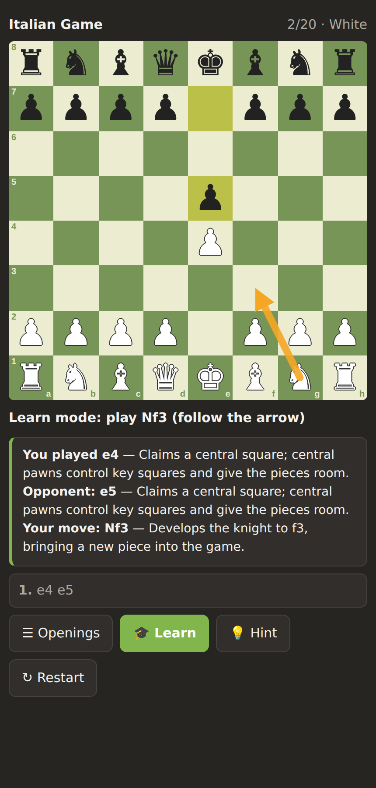
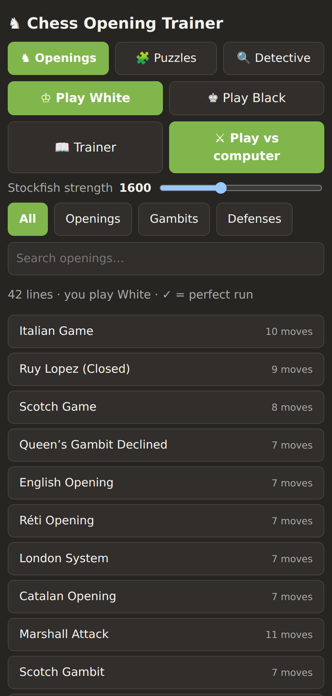
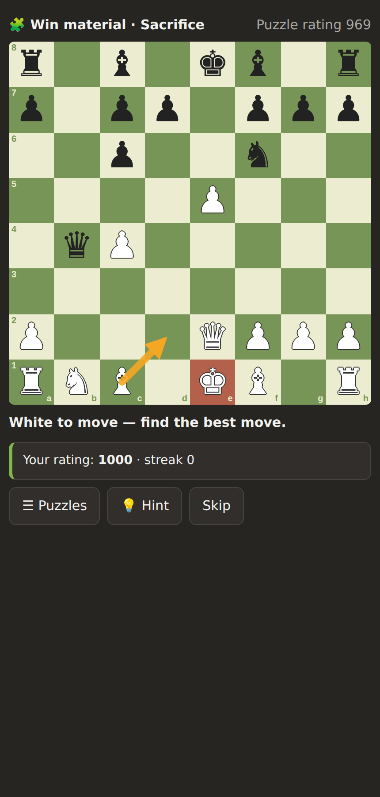
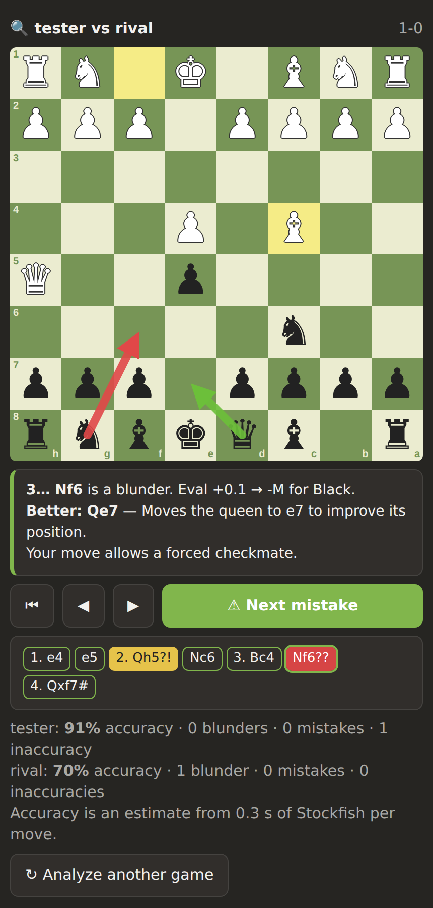

# ♞ Chess Trainer

An offline chess opening trainer with a chess.com-style board, Stockfish to play against, adaptive puzzles and a
"blunder detective" that reviews your games. It runs from a **single HTML file**, and the same code is packaged as a
Windows installer, an Android APK and an iPhone home-screen app. No account, no server and no AI service is needed.

| Openings with arrows | Play vs Stockfish | Adaptive puzzles | Blunder detective |
|:--:|:--:|:--:|:--:|
|  |  |  |  |

## Features

- **Opening trainer.** 42 main lines covering openings, gambits and defenses (Italian, Ruy Lopez, Evans, King's and Danish
  gambits, Sicilian Najdorf and Dragon, French, Caro-Kann, King's Indian, Grünfeld, Nimzo-Indian and more).
  Play either White or Black. **Learn mode** draws an arrow for the book move and explains each move; turn it off to
  test yourself, or tap **Hint**. Search and filter by openings, gambits or defenses.
- **Play vs computer.** Pick any opening and play against it. The computer follows the book while you do; if you leave
  the book it keeps playing with Stockfish. An **Elo slider (800 to Max)** sets its strength, and you can change it
  mid-game. Undo and hints (the engine's best move) are available.
- **Adaptive puzzles.** 275 tactics puzzles, each checked by Stockfish to have one best answer. Your puzzle rating moves
  up when you solve a puzzle first try and down when you miss or need a hint, and the next puzzle is picked near your
  rating. Ratings are estimates, not data from real players.
- **Blunder detective.** Paste a chess.com game link and your username (internet needed), or paste any game's PGN
  (works offline). Stockfish reviews every move, labels inaccuracies, mistakes and blunders, shows the better move as an
  arrow with an explanation, and estimates accuracy for both sides.
- **Offline and private.** Everything runs on your device. The only network call is the optional chess.com game import.

## Download

Prebuilt files are attached to each [release](../../releases). All of them contain the same app.

| Platform | File | How to use |
|---|---|---|
| Any browser | `chess-trainer-offline.html` | Save it and open it. Nothing to install. |
| Windows 10/11 | `ChessTrainer-Setup.exe` | Run it. It installs for your user and adds shortcuts. Because it is not code-signed, SmartScreen will warn: choose **More info, then Run anyway**. |
| Android 5.0+ | `ChessTrainer.apk` | Open it and allow installs from this source. It is signed with a self-made key, so Play Protect may warn. |
| iPhone / iPad | `ChessTrainer-iPhone-PWA.zip` | Host the unzipped folder on any https site (Netlify Drop, GitHub Pages, Cloudflare Pages), open it in Safari, then Share, **Add to Home Screen**. It works offline afterwards. |

There is no App Store build: that needs a Mac and a paid Apple developer account.

## Build from source

You need Python 3. Each platform has its own extra tools.

```bash
python3 tools/build_offline.py            # dist/chess-trainer-offline.html (one self-contained file)
python3 platforms/ios-pwa/build.py        # dist/ChessTrainer-iPhone-PWA.zip   (needs Pillow)
bash platforms/android/build.sh           # dist/ChessTrainer.apk
bash platforms/windows/build.sh           # dist/ChessTrainer-Setup.exe
```

- **Android:** `sudo apt install default-jdk-headless aapt zipalign apksigner dalvik-exchange libandroid-23-java`.
  The APK is signed with a debug key generated on first run (`platforms/android/debug.keystore`, git-ignored).
- **Windows:** `sudo apt install nsis unzip curl`. The script downloads Electron 33.2.0 (or set `ELECTRON_ZIP`).
  It runs on Linux, macOS or WSL.
- **Icons:** `tools/make_icons.py` needs Pillow and the DejaVu Sans font.

The version number lives in the `VERSION` file.

### Repository layout

```
src/index.template.html     the whole app (HTML, CSS, JavaScript); __PUZZLES__ is filled in at build time
data/puzzles.json           275 rated puzzles
data/opening_lines.json     opening lines used by the puzzle miner
vendor/chess.js/            chess.js 0.10.3 (BSD-2-Clause), rules and move generation
vendor/stockfish/           Stockfish 11 WebAssembly build via stockfish.js (GPL-3.0)
tools/                      build_offline.py, make_icons.py, mine_puzzles.py, rerate_puzzles.py
platforms/                  android/, windows/, ios-pwa/ packaging
docs/screenshots/           images used in this README
```

### Making more puzzles

```bash
sudo apt install stockfish && pip install chess
python3 tools/mine_puzzles.py 1 900 100    # seed, seconds, target count -> tools/mined/puz_1.json
python3 tools/rerate_puzzles.py            # rate them and rewrite data/puzzles.json
python3 tools/build_offline.py
```

Puzzle difficulty is estimated from how deep Stockfish has to search to settle on the answer, plus the length of the
solution and whether it involves a sacrifice.

## How it works

- Rules, legal moves and PGN handling use chess.js. Stockfish runs in a Web Worker created from the embedded WebAssembly,
  so the app needs no files next to it.
- The Elo slider uses Stockfish's `UCI_LimitStrength` and `UCI_Elo` between 1350 and 2850, its skill levels below that,
  and full strength at Max.
- Game review scores the best move and the move you played from the same position (about 0.3 s each), compares the
  win chances, and labels the drop with Lichess-style thresholds.
- The Android app is a thin WebView around the same file; the Windows app is Electron around the same file.

## Known limitations

- Each opening is one main line, not a full repertoire tree, and move explanations are generated from the move itself
  (capture, development, check and so on) rather than hand-written. Only the one-line plan for each opening is written by hand.
- The engine is Stockfish 11 (not the newest) running in WebAssembly, so game review is quick rather than deep.
  Borderline move labels and accuracy percentages will not match chess.com exactly.
- chess.com import needs your username and finds games from the player's last 12 months. Chess960 is not supported.
  Pasting the PGN always works.
- Most puzzles are fairly easy (about 60 are rated above 700), so strong players will see repeats.
- The Windows, Android and iPhone packages were built and checked with automated tests in a desktop browser, but have not
  been tested on every device.

## Contributing

Issues and pull requests are welcome. Good first contributions: more opening lines, hand-written move explanations,
harder puzzles, and translations.

## License

The code in this repository is released under the [MIT License](LICENSE).

The bundled **Stockfish** engine is licensed under the **GPL-3.0**, so the single-file builds that embed it
(the HTML file, installer, APK and iPhone package) are distributed under GPL-3.0 terms for that part.
chess.js is BSD-2-Clause. See [THIRD_PARTY_NOTICES.md](THIRD_PARTY_NOTICES.md) for details.
